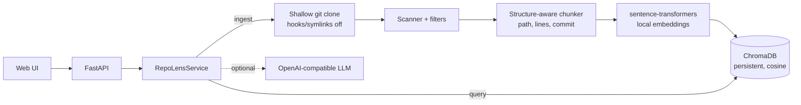

# RepoLens AI

[English](#english) | [Português](#português-brasil)

---

## English

Index a small public GitHub repository (Python + Markdown), search it semantically and get answers that cite **file, line range and commit SHA**. Search runs fully locally (sentence-transformers + ChromaDB); an LLM is optional.

### Architecture



| Module | Role |
| --- | --- |
| `ingest/github.py` | Accepts only `https://github.com/<owner>/<repo>`; shallow clone with timeout and size cap |
| `ingest/scanner.py`, `filters.py` | Limits on files/bytes; skips `.git`, dependencies, secrets, binaries, symlinks |
| `chunking.py` | Splits on Python defs/classes and Markdown headings; exact 1-based line ranges |
| `embeddings.py`, `store.py` | Local embeddings; persistent ChromaDB index |
| `service.py` | Ingest/query orchestration, evidence threshold, citation checks |
| `llm.py` | Optional OpenAI-compatible client |
| `citations.py` | GitHub permalinks and verification of a citation against a checkout |
| `evaluation.py` | Deterministic evaluation (hit@3, latency, citation validity) |

### Install and run

Requires Python 3.12 and `git`.

```bash
python -m venv .venv && source .venv/bin/activate
pip install --extra-index-url https://download.pytorch.org/whl/cpu -e ".[dev]"   # CPU-only torch
cp .env.example .env        # optional; never commit .env
uvicorn repolens.api:app_factory --factory --port 8000
```

Open <http://localhost:8000> (UI) or <http://localhost:8000/docs> (OpenAPI). The first ingest downloads the embedding model (~90 MB).

Docker: `docker build -t repolens-ai . && docker run -p 8000:8000 -v repolens-data:/data repolens-ai`. A devcontainer is provided in `.devcontainer/`.

```bash
curl -X POST localhost:8000/ingest -H 'content-type: application/json' \
  -d '{"repo_url": "https://github.com/pallets/click"}'
curl -X POST localhost:8000/query -H 'content-type: application/json' \
  -d '{"question": "How does click prompt for a hidden password?", "top_k": 3}'
```

### API

- `GET /health` – status, indexed chunks, embedding model, whether an LLM is configured.
- `POST /ingest` – `{"repo_url": ...}`; returns commit SHA, counts, skipped files by reason, `truncated` flag.
- `POST /query` – `{"question", "top_k", "repo", "generate"}`; returns `status` (`answered`, `retrieval_only`, `insufficient_evidence`), optional `answer`, and `sources` (path, lines, commit, score, permalink, text).
- `GET /repos` – indexed repositories.

### Optional LLM (v0.2.0: Gemini)

Set `REPOLENS_LLM_MODEL` (and `REPOLENS_LLM_BASE_URL` / `REPOLENS_LLM_API_KEY`) for any OpenAI-compatible `/chat/completions` endpoint. Gemini example:

```bash
export REPOLENS_LLM_BASE_URL=https://generativelanguage.googleapis.com/v1beta/openai/
export REPOLENS_LLM_MODEL=gemini-3.8-flash
export REPOLENS_LLM_REASONING_EFFORT=low        # sent only when set; leave empty for other providers
export REPOLENS_LLM_API_KEY=...                  # e.g. a Codespaces secret; never commit it
# optional, enables cost *estimates* only (USD per 1M tokens):
export REPOLENS_LLM_INPUT_PRICE_PER_MTOK=0.75 REPOLENS_LLM_OUTPUT_PRICE_PER_MTOK=3.75
```

- Answers must cite retrieved excerpts as `[n]`; the service checks that each `[n]` refers to a retrieved excerpt (answers without one are discarded); the evaluation harness additionally verifies cited ranges against the file at the indexed commit.
- If the provider fails (e.g. HTTP 503, timeout), `/query` falls back to `retrieval_only` (semantic retrieval with sources) and reports `llm.error`.
- `/query` returns `retrieval_ms` and `llm` (model, prompt/completion/total tokens, latency, estimated cost). The `repolens.llm` logger records the same, never request bodies or keys.
- Repository text is untrusted: delimiters are neutralized, paths escaped, and the prompt forbids following instructions in excerpts (reduces, does not eliminate, injection risk).
- Costs are estimates at the configured list prices; the Free Tier is billed at $0. Billing tier cannot be read via the API.

### Evaluation

`eval/dataset.json` holds 12 hand-written questions over `eval/fixture_repo` (7 single-file, 3 multi-file, 2 unanswerable) with expected files and required facts. Retrieval is scored by hit@3/hit@5 and exact citation validity:

```bash
python -m repolens.evaluation --embedder hashing --output eval/results.json   # offline, deterministic (CI)
```

Measured offline (hashing embedder, committed in `eval/results.json`): 10 answerable questions, **hit@3 = 1.00, hit@5 = 1.00**, citation validity 1.00. This is a lexical baseline on a tiny fixture, not a general quality claim.

Generative evaluation (`python -m repolens.rag_evaluation`) measures fact coverage (presence of human-written fact patterns; it is not polarity-aware, so a contradicting answer can still match), lexical claim support against cited excerpts, citation validity, abstention, latency, tokens and estimated cost, without an LLM judge. Live runs need `--allow-live` and a hard call cap (`--max-calls`, default 12); responses are recorded for offline `--mode replay`. Validated live with `gemini-3.5-flash-lite` (7 real calls, hashing embedder, not semantic embeddings); `gemini-3.8-flash` stays configurable but returned HTTP 503 in our attempts. Replay offline: `python -m repolens.rag_evaluation --mode replay --embedder hashing --recording eval/recordings/gemini-3.5-flash-lite.json`. Results and caveats: [docs/reports/GEMINI_RAG_EVALUATION.md](docs/reports/GEMINI_RAG_EVALUATION.md).

### Tests and lint

```bash
ruff check . && ruff format --check .
pytest -q                 # no network, no API cost (uses a deterministic hashing embedder)
pytest -q -m slow         # also loads the real model (needs network/cache)
```

CI (`.github/workflows/ci.yml`) runs lint, tests, the offline eval and a Docker build on every pull request.

### Security

- Imported code is never executed: only `git clone` runs, with hooks and global/system Git configuration disabled, symlinks disabled, only HTTPS to github.com, a clean environment, timeout and size cap. Files are only read as UTF-8 text.
- Skipped: `.git`, `node_modules`, venvs, `vendor`, build output, `.env*`, key/cert files, files matching common secret patterns (private keys, AWS, GitHub, Slack, OpenAI-style tokens), binaries, non-UTF-8, symlinks, oversized files.
- Retrieved text is sent to the LLM as untrusted data; the system prompt forbids following instructions inside it. This reduces, but does not eliminate, prompt-injection risk.
- No API keys are bundled; `.env` is git-ignored.
- The service has no authentication or rate limiting. Do not expose it publicly as-is; `/ingest` makes the server clone arbitrary public repos.

### Limitations

- Only public GitHub repos, default branch, shallow clone; only `.py` and `.md`.
- Default limits: 300 files, 200 KB per file, 5 MB total (see `.env.example`). Partial indexes are flagged with `truncated`.
- Secret detection is pattern-based and can miss secrets.
- Ranking ties beyond the 20-candidate over-fetch are not fully deterministic.
- Re-ingesting stages a new index generation and switches to it only after success; one embedding model per collection.
- Similarity threshold (`REPOLENS_MIN_SCORE`, default 0.25) is heuristic and not tuned per model/domain.
- Evaluation uses a small fixture; generative metrics are lexical (no LLM judge) and the live Gemini result depends on provider availability (see the report).
- Verification of citations in the API relies on the stored commit; permalinks require the commit to exist upstream.

---

## Português (Brasil)

Indexe um repositório público pequeno do GitHub (Python + Markdown), faça buscas semânticas e receba respostas que citam **arquivo, intervalo de linhas e SHA do commit**. A busca roda 100% localmente (sentence-transformers + ChromaDB); o uso de LLM é opcional.

### Arquitetura

O diagrama acima descreve o fluxo: o clone raso passa por scanner/filtros, fragmentação com metadados (caminho, linhas, commit), embeddings locais e índice ChromaDB persistente. A consulta busca no índice e, opcionalmente, envia os trechos a um LLM compatível com OpenAI. Os módulos estão listados na tabela da seção em inglês.

### Instalação e execução

Requer Python 3.12 e `git`.

```bash
python -m venv .venv && source .venv/bin/activate
pip install --extra-index-url https://download.pytorch.org/whl/cpu -e ".[dev]"
cp .env.example .env        # opcional; nunca versione o .env
uvicorn repolens.api:app_factory --factory --port 8000
```

Abra <http://localhost:8000> (interface) ou <http://localhost:8000/docs> (OpenAPI). A primeira ingestão baixa o modelo de embeddings (~90 MB). Docker: `docker build -t repolens-ai . && docker run -p 8000:8000 -v repolens-data:/data repolens-ai`. Há também um devcontainer.

### Demonstração

1. Inicie o servidor e abra a interface.
2. Indexe `https://github.com/pallets/click`.
3. Pergunte "How does click prompt for a hidden password?" e confira as fontes (arquivo, linhas, commit, link permanente).
4. Pergunte algo sem relação (ex.: receita de bolo): a resposta é `insufficient_evidence`.

### LLM opcional (v0.2.0: Gemini)

Configure `REPOLENS_LLM_BASE_URL`, `REPOLENS_LLM_MODEL` e `REPOLENS_LLM_API_KEY` para qualquer endpoint compatível com OpenAI. Exemplo Gemini: base `https://generativelanguage.googleapis.com/v1beta/openai/`, modelo `gemini-3.8-flash`, `REPOLENS_LLM_REASONING_EFFORT=low` (enviado só se definido). A chave vem de variável de ambiente (ex.: Codespaces Secret) e nunca deve ser commitada.

- Respostas devem citar `[n]`; o serviço confere que cada `[n]` aponta para um trecho recuperado (respostas sem isso são descartadas) e a avaliação verifica os intervalos contra o arquivo no commit indexado.
- Se o provedor falhar (ex.: HTTP 503, timeout), `/query` volta para `retrieval_only` (recuperação semântica com fontes) e informa `llm.error`.
- `/query` devolve `retrieval_ms` e `llm` (modelo, tokens, latência, custo estimado); o logger `repolens.llm` registra o mesmo, sem corpo de requisição nem chaves.
- Custos são estimativas pelos preços configurados (`REPOLENS_LLM_INPUT_PRICE_PER_MTOK`/`OUTPUT`); no Free Tier a cobrança é $0. O nível de faturamento não é consultável pela API.
- Trechos do repositório são dados não confiáveis (delimitadores neutralizados, instruções ignoradas); isso reduz, mas não elimina, o risco de prompt injection.

### Avaliação

`eval/dataset.json` tem 12 perguntas escritas à mão sobre `eval/fixture_repo` (7 de um arquivo, 3 multiarquivo, 2 sem evidência), com arquivos e fatos esperados. Medido offline (embedder hashing, `eval/results.json`): 10 perguntas respondíveis, **hit@3 = 1,00, hit@5 = 1,00**, validade das citações 1,00 — baseline lexical em fixture pequeno, não uma afirmação geral de qualidade.

A avaliação generativa (`python -m repolens.rag_evaluation`) mede cobertura de fatos escritos à mão (presença de padrões; não detecta negação), suporte lexical das afirmações, validade das citações, abstenção, latência, tokens e custo estimado, sem LLM como juiz. Chamadas reais exigem `--allow-live` e limite rígido (`--max-calls`, padrão 12); as respostas são gravadas para `--mode replay` offline. Validado ao vivo com `gemini-3.5-flash-lite` (7 chamadas reais, embedder hashing, não embeddings semânticos); `gemini-3.8-flash` continua configurável, mas retornou HTTP 503. Replay offline: `python -m repolens.rag_evaluation --mode replay --embedder hashing --recording eval/recordings/gemini-3.5-flash-lite.json`. Resultados e limitações: [docs/reports/GEMINI_RAG_EVALUATION.md](docs/reports/GEMINI_RAG_EVALUATION.md).

### Testes

```bash
ruff check . && ruff format --check .
pytest -q            # sem rede e sem custo de API
pytest -q -m slow    # carrega o modelo real
```

O CI roda lint, testes, avaliação offline e build do Docker em cada Pull Request.

### Segurança

- Código importado nunca é executado: apenas `git clone` raso, sem hooks nem configuração Git global/do sistema, sem symlinks, somente HTTPS para github.com, com timeout e limite de tamanho. Arquivos são lidos apenas como texto UTF-8.
- Ignorados: `.git`, dependências, `.env*`, chaves/certificados, padrões comuns de segredos, binários, symlinks e arquivos grandes.
- Trechos recuperados são enviados ao LLM como dados não confiáveis; isso reduz, mas não elimina, o risco de prompt injection.
- Nenhuma chave é incluída; `.env` está no `.gitignore`.
- A API não tem autenticação nem rate limit: não a exponha publicamente sem proteção.

### Limitações

- Apenas repositórios públicos do GitHub (branch padrão), arquivos `.py` e `.md`.
- Limites padrão: 300 arquivos, 200 KB por arquivo, 5 MB no total; índices parciais são sinalizados com `truncated`.
- A detecção de segredos é por padrões e pode falhar.
- Uma reindexação só substitui a geração ativa quando a nova geração está completa.
- O limiar de similaridade (padrão 0,25) é heurístico.
- Fixture pequeno; métricas generativas são lexicais (sem juiz LLM) e o resultado live do Gemini depende da disponibilidade do provedor (veja o relatório).

## License

MIT
