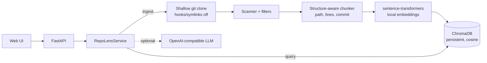

# RepoLens AI

[English](#english) | [Português](#português-brasil)

---

## English

Index a small public GitHub repository (Python + Markdown), search it semantically and get answers that cite **file, line range and commit SHA**. Search runs fully locally (sentence-transformers + ChromaDB); an LLM is optional.

### Architecture



| Module | Role |
| --- | --- |
| `ingest/github.py` | Accepts only `https://github.com/<owner>/<repo>`; shallow clone with timeout and size cap |
| `ingest/scanner.py`, `filters.py` | Limits on files/bytes; skips `.git`, dependencies, secrets, binaries, symlinks |
| `chunking.py` | Splits on Python defs/classes and Markdown headings; exact 1-based line ranges |
| `embeddings.py`, `store.py` | Local embeddings; persistent ChromaDB index |
| `service.py` | Ingest/query orchestration, evidence threshold, citation checks |
| `llm.py` | Optional OpenAI-compatible client |
| `citations.py` | GitHub permalinks and verification of a citation against a checkout |
| `evaluation.py` | Deterministic evaluation (hit@3, latency, citation validity) |

### Install and run

Requires Python 3.12 and `git`.

```bash
python -m venv .venv && source .venv/bin/activate
pip install --extra-index-url https://download.pytorch.org/whl/cpu -e ".[dev]"   # CPU-only torch
cp .env.example .env        # optional; never commit .env
uvicorn repolens.api:app_factory --factory --port 8000
```

Open <http://localhost:8000> (UI) or <http://localhost:8000/docs> (OpenAPI). The first ingest downloads the embedding model (~90 MB).

Docker: `docker build -t repolens-ai . && docker run -p 8000:8000 -v repolens-data:/data repolens-ai`. A devcontainer is provided in `.devcontainer/`.

```bash
curl -X POST localhost:8000/ingest -H 'content-type: application/json' \
  -d '{"repo_url": "https://github.com/pallets/click"}'
curl -X POST localhost:8000/query -H 'content-type: application/json' \
  -d '{"question": "How does click prompt for a hidden password?", "top_k": 3}'
```

### API

- `GET /health` – status, indexed chunks, embedding model, whether an LLM is configured.
- `POST /ingest` – `{"repo_url": ...}`; returns commit SHA, counts, skipped files by reason, `truncated` flag.
- `POST /query` – `{"question", "top_k", "repo", "generate"}`; returns `status` (`answered`, `retrieval_only`, `insufficient_evidence`), optional `answer`, and `sources` (path, lines, commit, score, permalink, text).
- `GET /repos` – indexed repositories.

### Optional LLM

Set `REPOLENS_LLM_MODEL` (and `REPOLENS_LLM_BASE_URL` / `REPOLENS_LLM_API_KEY` if needed) for any OpenAI-compatible `/chat/completions` endpoint, e.g. a local Ollama. Without a model, `/query` returns the retrieved excerpts and sources only; no answer is ever simulated. A generated answer without a valid `[n]` citation is discarded. If the best match scores below `REPOLENS_MIN_SCORE` or the model replies that evidence is insufficient, the status is `insufficient_evidence`.

### Evaluation

`eval/dataset.json` holds 8 hand-written questions with expected source files over `eval/fixture_repo`; no generated answers are used as ground truth. Each run commits the fixture to a throwaway git repo, indexes it, and measures hit@3, retrieval latency and whether each cited range matches the file at the cited commit exactly.

```bash
python -m repolens.evaluation --embedder model --output eval/results.json   # real model
python -m repolens.evaluation --embedder hashing                            # offline lexical baseline (CI)
```

Measured results (committed in `eval/results.json`, CPU, all-MiniLM-L6-v2, 8 questions): **hit@3 = 1.00**, **citation validity = 1.00**, retrieval latency mean 17.05 ms / median 16.07 ms / max 22.16 ms. The set is tiny and the fixture easy, so this is a smoke-level regression check, not a general quality claim. Re-run to reproduce; latency varies by machine.

### Tests and lint

```bash
ruff check . && ruff format --check .
pytest -q                 # no network, no API cost (uses a deterministic hashing embedder)
pytest -q -m slow         # also loads the real model (needs network/cache)
```

CI (`.github/workflows/ci.yml`) runs lint, tests, the offline eval and a Docker build on every pull request.

### Security

- Imported code is never executed: only `git clone` runs, with hooks and global/system Git configuration disabled, symlinks disabled, only HTTPS to github.com, a clean environment, timeout and size cap. Files are only read as UTF-8 text.
- Skipped: `.git`, `node_modules`, venvs, `vendor`, build output, `.env*`, key/cert files, files matching common secret patterns (private keys, AWS, GitHub, Slack, OpenAI-style tokens), binaries, non-UTF-8, symlinks, oversized files.
- Retrieved text is sent to the LLM as untrusted data; the system prompt forbids following instructions inside it. This reduces, but does not eliminate, prompt-injection risk.
- No API keys are bundled; `.env` is git-ignored.
- The service has no authentication or rate limiting. Do not expose it publicly as-is; `/ingest` makes the server clone arbitrary public repos.

### Limitations

- Only public GitHub repos, default branch, shallow clone; only `.py` and `.md`.
- Default limits: 300 files, 200 KB per file, 5 MB total (see `.env.example`). Partial indexes are flagged with `truncated`.
- Secret detection is pattern-based and can miss secrets.
- Re-ingesting stages a new index generation and switches to it only after success; one embedding model per collection.
- Similarity threshold (`REPOLENS_MIN_SCORE`, default 0.25) is heuristic and not tuned per model/domain.
- Evaluation covers retrieval on a small fixture only; answer quality with an LLM is not measured.
- Verification of citations in the API relies on the stored commit; permalinks require the commit to exist upstream.

---

## Português (Brasil)

Indexe um repositório público pequeno do GitHub (Python + Markdown), faça buscas semânticas e receba respostas que citam **arquivo, intervalo de linhas e SHA do commit**. A busca roda 100% localmente (sentence-transformers + ChromaDB); o uso de LLM é opcional.

### Arquitetura

O diagrama acima descreve o fluxo: o clone raso passa por scanner/filtros, fragmentação com metadados (caminho, linhas, commit), embeddings locais e índice ChromaDB persistente. A consulta busca no índice e, opcionalmente, envia os trechos a um LLM compatível com OpenAI. Os módulos estão listados na tabela da seção em inglês.

### Instalação e execução

Requer Python 3.12 e `git`.

```bash
python -m venv .venv && source .venv/bin/activate
pip install --extra-index-url https://download.pytorch.org/whl/cpu -e ".[dev]"
cp .env.example .env        # opcional; nunca versione o .env
uvicorn repolens.api:app_factory --factory --port 8000
```

Abra <http://localhost:8000> (interface) ou <http://localhost:8000/docs> (OpenAPI). A primeira ingestão baixa o modelo de embeddings (~90 MB). Docker: `docker build -t repolens-ai . && docker run -p 8000:8000 -v repolens-data:/data repolens-ai`. Há também um devcontainer.

### Demonstração

1. Inicie o servidor e abra a interface.
2. Indexe `https://github.com/pallets/click`.
3. Pergunte "How does click prompt for a hidden password?" e confira as fontes (arquivo, linhas, commit, link permanente).
4. Pergunte algo sem relação (ex.: receita de bolo): a resposta é `insufficient_evidence`.

### LLM opcional

Defina `REPOLENS_LLM_MODEL` (e `REPOLENS_LLM_BASE_URL` / `REPOLENS_LLM_API_KEY`, se necessário) para qualquer endpoint `/chat/completions` compatível com OpenAI, como o Ollama local. Sem modelo configurado, `/query` devolve apenas trechos e fontes; nenhuma resposta é simulada. Respostas sem citação `[n]` válida são descartadas. Se a melhor correspondência ficar abaixo de `REPOLENS_MIN_SCORE`, ou o modelo indicar evidência insuficiente, o status é `insufficient_evidence`.

### Avaliação

`eval/dataset.json` tem 8 perguntas escritas à mão, com arquivos esperados, sobre `eval/fixture_repo`; respostas geradas nunca são usadas como verdade de referência. Resultado medido (arquivo `eval/results.json`, CPU, all-MiniLM-L6-v2): **hit@3 = 1,00**, **validade das citações = 1,00**, latência de busca média 17,05 ms / mediana 16,07 ms / máx. 22,16 ms. O conjunto é pequeno e o fixture simples: serve como teste de regressão, não como afirmação geral de qualidade. Comandos: veja a seção em inglês.

### Testes

```bash
ruff check . && ruff format --check .
pytest -q            # sem rede e sem custo de API
pytest -q -m slow    # carrega o modelo real
```

O CI roda lint, testes, avaliação offline e build do Docker em cada Pull Request.

### Segurança

- Código importado nunca é executado: apenas `git clone` raso, sem hooks nem configuração Git global/do sistema, sem symlinks, somente HTTPS para github.com, com timeout e limite de tamanho. Arquivos são lidos apenas como texto UTF-8.
- Ignorados: `.git`, dependências, `.env*`, chaves/certificados, padrões comuns de segredos, binários, symlinks e arquivos grandes.
- Trechos recuperados são enviados ao LLM como dados não confiáveis; isso reduz, mas não elimina, o risco de prompt injection.
- Nenhuma chave é incluída; `.env` está no `.gitignore`.
- A API não tem autenticação nem rate limit: não a exponha publicamente sem proteção.

### Limitações

- Apenas repositórios públicos do GitHub (branch padrão), arquivos `.py` e `.md`.
- Limites padrão: 300 arquivos, 200 KB por arquivo, 5 MB no total; índices parciais são sinalizados com `truncated`.
- A detecção de segredos é por padrões e pode falhar.
- Uma reindexação só substitui a geração ativa quando a nova geração está completa.
- O limiar de similaridade (padrão 0,25) é heurístico.
- A avaliação cobre só a recuperação em um fixture pequeno; a qualidade das respostas do LLM não é medida.

## License

MIT
